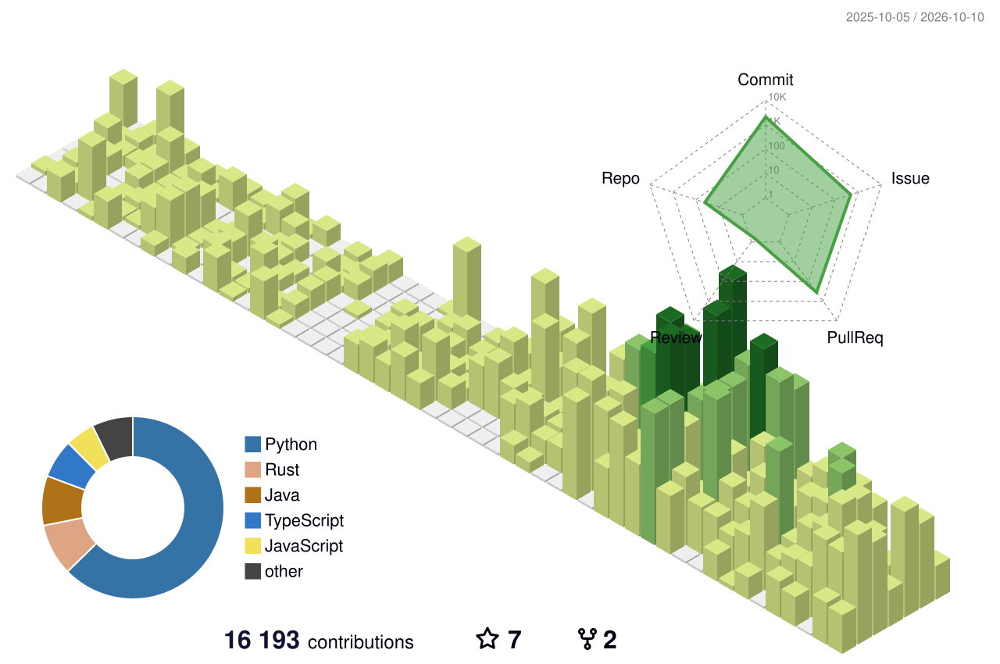

# Hi, I'm Djairo Dantas 👋

**Full-stack & AI engineer · Computer Science at Insper**

A teacher once told my class that programmers solve problems. That idea stuck.
I build products and systems end to end, from backend architecture and AI
workflows to the interfaces people use, choosing tools to fit the job.

## Selected work

- **[MedAgenda](https://github.com/djairofilho/medagenda-poc-agent)**:
  multi-agent proof of concept for clinic triage, information, and scheduling.
- **[Sider](https://github.com/djairofilho/sider)**: an in-memory database
  server in Rust with an incremental Redis-compatible core.
- **[Periodic Table Battleship RL](https://github.com/djairofilho/periodic-table-battleship-rl)**:
  a Gymnasium environment and reinforcement learning benchmark built around
  Battleship on the periodic table.

## Tools I use

Technologies and practices I've used across products, client projects,
coursework, and experiments:

**Languages**

**Frontend**

**Backend**

**Databases & data**

**AI**

**Cloud & infrastructure**

**Security**

**Other**

<picture>
  <source media="(prefers-color-scheme: dark)" srcset="./profile-3d-contrib/profile-night-green.svg">
  
</picture>
